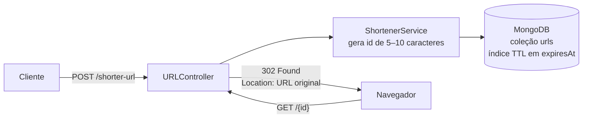

# url-shortener

Encurtador de URLs com **Spring Boot** e **MongoDB**. Cada link curto recebe um identificador alfanumérico aleatório e expira automaticamente por meio de um **índice TTL** do MongoDB. Ao acessar o link curto, a API responde com um redirecionamento **HTTP 302** para a URL original.

## Arquitetura



- **Geração do id:** `RandomStringUtils.randomAlphanumeric(5, 10)`. Se o id já existir, outro é gerado até encontrar um livre.
- **Expiração:** cada documento guarda `expiresAt = agora + 1 minuto`. O campo tem um índice TTL (`@Indexed(expireAfterSeconds = 0)`), e o próprio MongoDB apaga o documento quando esse horário passa, sem nenhum job de limpeza na aplicação. A tarefa de TTL do MongoDB roda a cada 60 segundos, então um link pode durar até cerca de 1 minuto além do previsto.
- **Redirecionamento:** `GET /{id}` responde `302 Found` com o header `Location` apontando para a URL original.

## Tecnologias

- Java 21
- Spring Boot 3.3 (Web, Data MongoDB)
- MongoDB (índice TTL)
- Apache Commons Lang 3
- springdoc-openapi (Swagger UI)
- Lombok
- Docker Compose

## Como rodar localmente

Pré-requisitos: Java 21 e Docker. Não é preciso instalar o Maven: o projeto usa o Maven Wrapper.

```bash
# 1. Suba o MongoDB (usuário admin / senha 123)
docker compose -f docker/docker-compose.yml up -d

# 2. Rode a aplicação (no Windows, use mvnw.cmd)
./mvnw spring-boot:run
```

A aplicação sobe em `http://localhost:8080` e usa o banco `shortenerdb`. O índice TTL é criado automaticamente na inicialização (`auto-index-creation=true`).

## Documentação da API (Swagger)

- Swagger UI: http://localhost:8080/swagger-ui.html
- OpenAPI (JSON): http://localhost:8080/v3/api-docs

## Endpoints

### `POST /shorter-url`: encurta uma URL

```bash
curl -X POST http://localhost:8080/shorter-url \
  -H "Content-Type: application/json" \
  -d '{ "URL": "https://munhosdev.com" }'
```

Resposta `200 OK`:

```json
{ "URL": "http://localhost:8080/o0Prlkz0" }
```

### `GET /{id}`: redireciona para a URL original

```bash
curl -i http://localhost:8080/o0Prlkz0
```

```http
HTTP/1.1 302
Location: https://munhosdev.com
Content-Length: 0
```

Aberto no navegador, o link curto leva direto para a URL original. Depois que o link expira, a requisição não é mais redirecionada.

### `GET /getALlUrls`: lista os links ativos

```bash
curl http://localhost:8080/getALlUrls
```

```json
[
  {
    "id": "o0Prlkz0",
    "fullUrl": "https://munhosdev.com",
    "expiresAt": "2026-10-15T18:21:31.577"
  }
]
```

## Estrutura do projeto

```
src/main/java/br/com/munhosdev/urlshortener
├── controller/   # URLController (encurtar, redirecionar, listar)
├── domain/       # URLEntity (documento com expiresAt/TTL) e UrlDTO
├── repository/   # URLRepository (Spring Data MongoDB)
└── service/      # Geração de id, persistência e montagem do redirect
```
